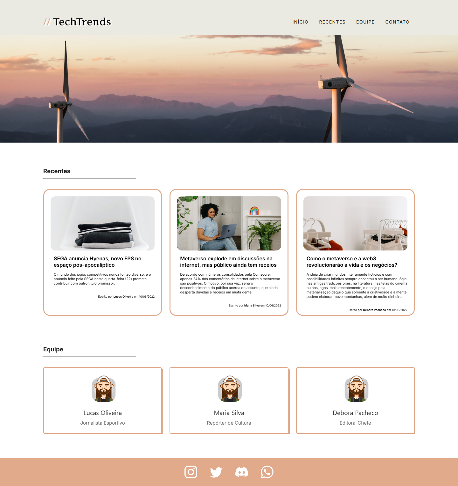

# TechTrends

[](https://plovatto.github.io/BlogTech/)

<p align="center"><a href="https://plovatto.github.io/BlogTech/"><strong>Ver o projeto ao vivo →</strong></a></p>

Blog de notícias de tecnologia desenvolvido com Vue 3 e Vuetify, consumindo publicações, autores e imagens de uma API REST própria.

O projeto foi criado em 2023, durante meus estudos de front-end, para praticar componentização com Vue, roteamento, consumo de APIs e layouts responsivos com Vuetify.

> **Nota:** Este é um projeto de estudo. O blog, as notícias e a equipe são fictícios.

> **Primeiro acesso:** a API está hospedada no plano gratuito do Render, que hiberna quando fica sem uso. Na primeira visita, as publicações podem levar até 1 minuto para carregar.

## Demo

O projeto está publicado no GitHub Pages: **[plovatto.github.io/BlogTech](https://plovatto.github.io/BlogTech/)**

|                          Página inicial                          |                      Publicação                      |
| :--------------------------------------------------------------: | :--------------------------------------------------: |
|  |  |

## Funcionalidades

- Header com navegação entre as seções e menu lateral em telas menores
- Banner de destaque na página inicial
- Carrossel de publicações recentes com imagem, resumo, autor e data
- Página individual para cada publicação
- Carrossel da equipe com cargos e redes sociais
- Footer com links de redes sociais
- Indicador de carregamento enquanto a API responde
- Dados carregados de uma API REST com Axios
- Deploy automatizado com GitHub Actions e GitHub Pages

## Tecnologias

- [Vue.js](https://vuejs.org/) 3
- [Vuetify](https://vuetifyjs.com/) 3 - componentes de interface
- [Vue Router](https://router.vuejs.org/) 4 - rotas da aplicação
- [Axios](https://axios-http.com/) - requisições HTTP
- [Material Design Icons](https://pictogrammers.com/library/mdi/) - ícones
- Vue CLI - build e servidor de desenvolvimento
- ESLint - análise do código
- GitHub Actions - deploy automatizado
- GitHub Pages - hospedagem

## Como Executar

### Pré-requisitos

Antes de começar, tenha instalado:

- [Node.js](https://nodejs.org/)
- npm

### Instalação

Clone o repositório:

```bash
git clone https://github.com/Plovatto/BlogTech.git
```

Acesse a pasta do projeto:

```bash
cd BlogTech
```

Instale as dependências:

```bash
npm install
```

Execute o servidor de desenvolvimento:

```bash
npm run serve
```

O projeto estará disponível em:

```text
http://localhost:8080
```

## Scripts

| Comando         | Descrição                                |
| --------------- | ---------------------------------------- |
| `npm run serve` | Inicia o servidor de desenvolvimento     |
| `npm run build` | Gera o build de produção na pasta `dist` |
| `npm run lint`  | Executa a análise do código com ESLint   |

## API

As publicações são carregadas de uma API REST desenvolvida em Node.js com Express. O endereço da API e as funções de busca ficam centralizados em `src/services/api.js`.

| Rota                  | Descrição                          |
| --------------------- | ---------------------------------- |
| `GET /postagens`      | Lista todas as publicações         |
| `GET /postagem/:id`   | Retorna uma publicação pelo índice |
| `GET /img/post-N.jpg` | Imagem de capa da publicação       |

## Estrutura do Projeto

```text
src/
├── assets/                 # Logo e imagem do banner
├── components/
│   ├── Header.vue          # Navegação e banner
│   ├── Recentes.vue        # Carrossel de publicações recentes
│   ├── Equipe.vue          # Carrossel da equipe
│   └── Footer.vue          # Redes sociais
├── mixins/
│   └── carrosselResponsivo.js  # Colunas dos carrosséis conforme a largura da tela
├── plugins/
│   └── vuetify.js          # Configuração do Vuetify
├── services/
│   └── api.js              # Cliente da API e funções de busca das publicações
├── views/
│   ├── Inicio.vue          # Página inicial
│   └── PaginaPostagem.vue  # Página de uma publicação (/postagem/:id)
├── App.vue
├── main.js
└── router.js
```

## Deploy

O deploy é feito com GitHub Actions para o GitHub Pages.

O workflow está em:

```text
.github/workflows/deploy.yml
```

O Vue CLI usa `publicPath: '/BlogTech/'` em produção para gerar os caminhos corretos dos assets no GitHub Pages. Como o GitHub Pages não tem suporte nativo a rotas de SPA, o workflow copia o `index.html` para `404.html`, permitindo abrir e recarregar diretamente páginas como `/BlogTech/postagem/0`.

Para publicar, configure no GitHub:

```text
Settings > Pages > Build and deployment > Source: GitHub Actions
```

A cada push na branch `main`, o workflow executa o lint, gera o build e publica a pasta `dist`.

## Objetivos do Projeto

O TechTrends foi desenvolvido com o objetivo de praticar e demonstrar conhecimentos em:

- Desenvolvimento de interfaces com Vue 3
- Uso de bibliotecas de componentes (Vuetify)
- Roteamento em aplicações SPA
- Consumo de APIs REST com Axios
- Criação de layouts responsivos
- Deploy de aplicações front-end

Este projeto foi desenvolvido para fins de estudo e portfólio.
